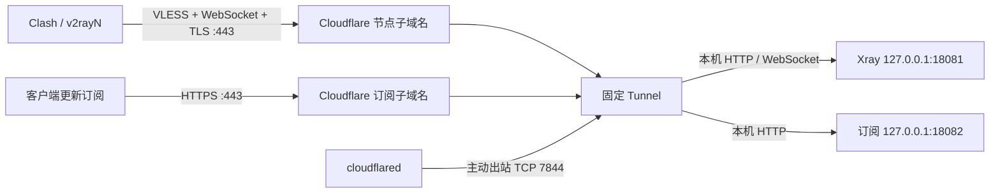

# 固定 Cloudflare Tunnel 实施方案

适用于 VPS 公网 IP 从客户端网络不可达，但 VPS 仍可访问 Cloudflare 的情况。脚本新增主菜单 **11**，接入控制台管理的命名隧道；使用固定子域名，不使用重启会变化的临时域名。

## 连接结构



新增独立 VLESS / WebSocket 入站，UUID 与路径首次生成，更新隧道时保留。客户端 TLS 在 Cloudflare 边缘终止，cloudflared 再通过环回地址访问本机服务；无需在 VPS 申请源站证书，也无需映射这两个入站端口。

现有 REALITY 节点、直接订阅、证书续期设置继续独立运行。普通菜单中的 UUID、SNI 和 NAT 配置管理 REALITY 节点；隧道设置在菜单 11 管理。重新安装节点前需先停用隧道。

## 需要准备的内容

| 项目 | 要求 / 示例 |
|---|---|
| 系统 | 已通过本脚本安装 Xray 的 Debian / Alpine x86_64，root 权限 |
| 域名 | 已托管到 Cloudflare，使用两个不同的完整子域名 |
| 节点域名 | `node.example.com` |
| 订阅域名 | `sub.example.com` |
| Tunnel | 控制台创建的 cloudflared 命名隧道及其 Token |
| VPS 出站 | DNS、下载依赖所需的 HTTPS，以及到 Cloudflare Tunnel 的 TCP 7844 |
| 客户端 | 支持 VLESS / WebSocket / TLS 的 mihomo 或 Xray |

节点和订阅的 DNS 由 Cloudflare 路由指向隧道，不再指向被阻断的 VPS 公网 IP。客户端仍需能够访问 Cloudflare 边缘网络，本方案不能保证所有大陆网络上的可达性或速度。

## Cloudflare 控制台配置

1. 进入 Cloudflare Zero Trust 的 Networks / Connectors / Cloudflare Tunnels，创建类型为 **cloudflared** 的隧道，名称例如 `xray-vps`。控制台栏目名称可能随版本变化。
2. 从安装指引中取得 Tunnel Token，只取 Token 字符串。无需向脚本提供账号全局 API Key，也不需要在服务器执行控制台给出的 `service install` 命令；脚本会创建自己的服务。
3. 在同一隧道添加两条 **Published application routes / Public Hostnames**：

   | 子域名 | Service 类型 | URL |
   |---|---|---|
   | `node.example.com` | HTTP | `127.0.0.1:18081` |
   | `sub.example.com` | HTTP | `127.0.0.1:18082` |

4. 两条路由的 Path 均留空。WebSocket 的随机路径由 Xray 校验，不要填入控制台的路由 Path。
5. 保存路由，让控制台创建对应 DNS 记录。若已有同名 A / AAAA / CNAME 记录，先解决冲突。确保域名边缘证书已生效，Cloudflare WebSockets 已开启。
6. 两个域名不使用需要浏览器登录的 Cloudflare Access 策略，也不使用客户端无法完成的交互挑战；否则订阅或 WebSocket 握手会被登录页、403 等响应拦截。

创建后暂时显示 connector offline 属正常现象，完成下一步启动 cloudflared 后会连接。

## VPS 配置

将包含新功能的 `xray.sh` 放到服务器，运行：

```sh
sh xray.sh 11
```

选择 **1「配置 / 更新固定隧道」**，依次填写：

1. 节点完整子域名。
2. 订阅完整子域名。
3. WebSocket 本机端口，默认 `18081`。
4. 隧道订阅本机端口，默认 `18082`。
5. 隧道 Token，隐藏输入；更新时回车可保留已有 Token。
6. 确认控制台两条路由的端口与上述端口一致，输入 `y` 应用。

脚本校验参数、端口和 Xray 候选配置后，从 Cloudflare 官方 GitHub release 下载 cloudflared，并验证 GitHub 发布摘要中的 SHA-256。已有支持 `--token-file` 的 `/usr/local/bin/cloudflared` 会复用。Token 通过文件传给服务，不出现在服务命令行中。

保存前备份原配置。应用后检查 Xray 入站、Tunnel `/ready`、本机订阅、两个公网域名的 HTTPS 订阅和 WebSocket 101 响应；失败会恢复原节点配置与隧道凭据，并尝试恢复原服务。DNS 或边缘证书尚未生效时也会触发回滚，修正后再配置即可。

可提前通过环境变量设置下列输入的默认值，仍需在菜单中确认。`XRAY_TUNNEL_TOKEN` 可由安全环境提供；不要把真实 Token 写进命令历史或公开文件。

| 变量 | 默认值 / 用途 |
|---|---|
| `TUNNEL_NODE_HOST` | 节点子域名 |
| `TUNNEL_SUB_HOST` | 订阅子域名 |
| `TUNNEL_WS_PORT` | `18081` |
| `TUNNEL_SUB_PORT` | `18082` |
| `TUNNEL_METRICS_PORT` | `20241`，仅本机监听的 cloudflared 检查端口 |
| `TUNNEL_WS_PATH` | 首次随机生成，更新时保留；自定义路径只允许 `/`、字母、数字、`_`、`-` |
| `XRAY_TUNNEL_TOKEN` | 当前操作使用的 Tunnel Token |

## 客户端接入

配置成功或选择菜单 **7**、菜单 **11 → 2**，可以查看固定隧道的分享链接和订阅：

```text
https://sub.example.com/<现有订阅口令>/clash.yaml
https://sub.example.com/<现有订阅口令>/vless.txt
https://sub.example.com/<现有订阅口令>/xray.json
```

- Clash Verge / mihomo：导入 `clash.yaml`，使用规则模式。沿用原订阅的策略组、DNS 和分流规则，代理节点替换为固定隧道节点。
- v2rayN：导入 `vless.txt` 或分享链接，使用 Xray 内核；原生订阅的分流由客户端控制。
- 完整 Xray 客户端配置：`xray.json` 保留原客户端的路由，将代理出站替换为 WebSocket + TLS。

手动填写时，地址 / SNI / WebSocket Host 均为节点子域名，端口 `443`，TLS 开启，传输 `ws`，路径以脚本输出为准，UUID 使用隧道 UUID，Flow 留空，不填写 REALITY 公钥或 ShortId。

公网自检通过仅说明从 VPS 所在网络访问 Cloudflare 路由正常。最终需在实际大陆客户端上更新订阅、测试 HTTPS 访问并使用代理打开网站。

## 更新、运维与恢复

| 操作 | 入口 / 行为 |
|---|---|
| 更新订阅规则 | 菜单 2；隧道订阅读取更新后的模板 |
| 轮换订阅访问口令 | 菜单 10 → 9；直接订阅和隧道订阅同步使用新口令，旧 URL 失效 |
| 查看地址 | 菜单 7 或 11 → 2 |
| 重启 | 菜单 8；重启节点、订阅与隧道并检查本机就绪状态 |
| 检查固定隧道 | 菜单 11 → 3；检查本机与公网路由 |
| 修改域名 / 本机端口 / Token | 菜单 11 → 1；同步修改控制台路由 |
| 日志 | 菜单 9 |
| 停用 | 菜单 11 → 4；停止隧道服务、移除其 WebSocket 入站，保留原 REALITY 节点 |

停用会删除当前 Token 文件，保留停用设置和 root 私有备份。控制台的 Tunnel、域名路由及 DNS 不自动删除；重新启用时需提供 Token。原 IP 仍被阻断时，停用隧道不会恢复直连可达性。

| 文件 / 服务 | 内容 |
|---|---|
| `/etc/xray/tunnel.json` | 隧道域名、独立 UUID、路径与本机端口，权限 `0600` |
| `/etc/xray/tunnel-token` | Tunnel Token，权限 `0600` |
| `/etc/xray/tunnel-backup-*` | 配置和凭据备份，目录权限 `0700`；含敏感信息 |
| `/usr/local/bin/cloudflared` | 隧道连接程序 |
| `xray-cloudflared` | systemd / OpenRC 隧道服务，自动重连与开机启动 |
| `xray-tunnel-sub` | systemd / OpenRC 本机隧道订阅服务 |

Debian 日志：

```sh
journalctl -u xray-cloudflared.service -u xray-tunnel-sub.service -n 80 --no-pager
```

Alpine 日志：

```sh
tail -n 80 /var/log/xray-cloudflared.log /var/log/xray-tunnel-sub.log
```

Tunnel offline 时先查 Token 和出站 TCP 7844；502 通常需要检查本机服务地址和端口；订阅返回 404 先核对最新口令；403 或登录页检查 Access / WAF；WebSocket 非 101 检查域名路由、WebSockets 开关和客户端路径。

## 验证

本地运行 `python tests/test_tunnel.py`，覆盖参数校验、端口冲突、客户端输出、真实 HTTP 订阅响应，以及配置提交、取消、启用 / 更新 / 停用失败回滚。测试不需要 Cloudflare 账号或真实 Token。

2026-11-05 在 Windows 和现有 Debian 12 VPS 上通过 17 项自动化测试。VPS 另使用隔离进程完成实际 Xray WebSocket 101 握手、错误路径拒绝、VLESS WebSocket 代理 HTTPS 出站、三种订阅响应、错误口令拒绝和口令轮换，验证前后原节点文件校验值一致。下载并校验 cloudflared `2026.10.7`，生成的 systemd 服务通过 `systemd-analyze verify`；OpenRC 脚本仅验证语法，未在 Alpine 上运行。

Linux 隔离集成验证入口为 `python3 tests/integration_tunnel.py`，要求本机已有 `/etc/xray/` 模板和 `/usr/local/bin/xray`，测试结束停止临时进程并清理临时配置。该测试验证本机 WebSocket 传输，不模拟 Cloudflare 的公网 TLS 终止。

真实 Tunnel 的连接、公网 TLS 域名路由和大陆客户端可达性，须在提供域名和 Token 后验证。

官方参考：

- [Cloudflare Tunnel 运行参数、Token 文件、HTTP/2 与指标接口](https://developers.cloudflare.com/cloudflare-one/networks/connectors/cloudflare-tunnel/configure-tunnels/cloudflared-parameters/run-parameters/)
- [WebSockets 支持](https://developers.cloudflare.com/network/websockets/)
